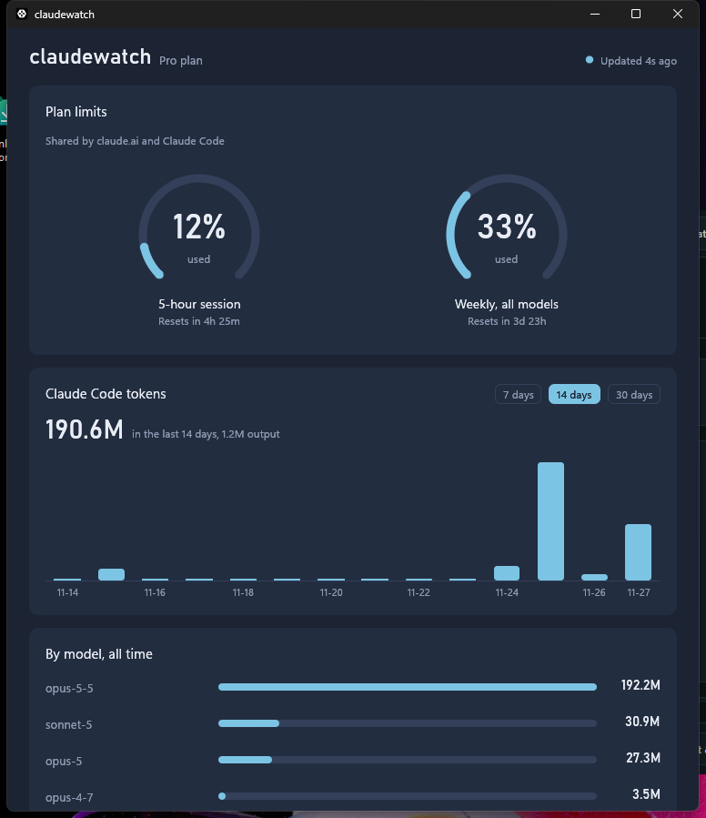

# claudewatch

A small desktop app that shows how much of your Claude plan you've used and how many tokens Claude Code has spent.



## What it shows

- **Plan limits**: each limit window Anthropic reports for your account (5-hour session, weekly, per-model weekly), with percent used and time until it resets. claude.ai and Claude Code share these limits.
- **Claude Code tokens**: a daily chart for the last 7, 14 or 30 days (UTC), with input, output and cache breakdown on hover, plus totals per model.

It refreshes every 5 seconds.

## Install

Download the archive for your platform from [Releases](https://github.com/DID-Software-Solutions/claudewatch/releases), unpack it and run `claudewatch` (`claudewatch.exe` on Windows).

| Platform | File |
|---|---|
| Windows x64 | `claudewatch-vX.Y.Z-windows-x64.zip` |
| Linux x64 | `claudewatch-vX.Y.Z-linux-x64.tar.gz` |
| macOS Apple Silicon | `claudewatch-vX.Y.Z-macos-arm64.tar.gz` |

The builds are unsigned. On macOS, clear the quarantine flag once: `xattr -d com.apple.quarantine claudewatch`. On Windows, SmartScreen may ask you to confirm.

## Requirements

You need to be signed in to [Claude Code](https://claude.com/claude-code) on the same machine. claudewatch reuses that login; it never asks for a password and stores nothing of its own except the chosen day range.

| Data | Source |
|---|---|
| Login token | `~/.claude/.credentials.json` (Windows, Linux) or the `Claude Code-credentials` Keychain item (macOS) |
| Plan limits | `GET https://api.anthropic.com/api/oauth/usage` |
| Token usage | `~/.claude/projects/**/*.jsonl` (Claude Code's local session logs) |

If the panel says your login expired, run any `claude` command to refresh it.

The usage endpoint is the one Claude Code itself uses; it isn't a documented public API and may change.

## Build from source

Requires a stable Rust toolchain (edition 2024). On Linux, also install `libxcb-render0-dev libxcb-shape0-dev libxcb-xfixes0-dev libxkbcommon-dev`.

```sh
cargo run --release
```

`scripts/build.sh` (or `scripts/build.ps1` on Windows) runs the same checks as CI (format, clippy, tests) and then a release build.

## Architecture

A single file, `src/main.rs`, built on [egui/eframe](https://github.com/emilk/egui):

- A background thread fetches plan limits and scans the session logs every 5 seconds, swaps the result into shared state and asks the window to repaint, so the UI never blocks.
- Log scanning sums the `usage` field of assistant messages per UTC day and per model.
- The UI draws dials for limits and a bar chart for daily tokens.

## Releasing

1. Bump `version` in `Cargo.toml` and add a section to `CHANGELOG.md`.
2. Push a tag `vX.Y.Z`. The release workflow builds all three platforms and publishes a GitHub release with that changelog section as notes.

## License

MIT
